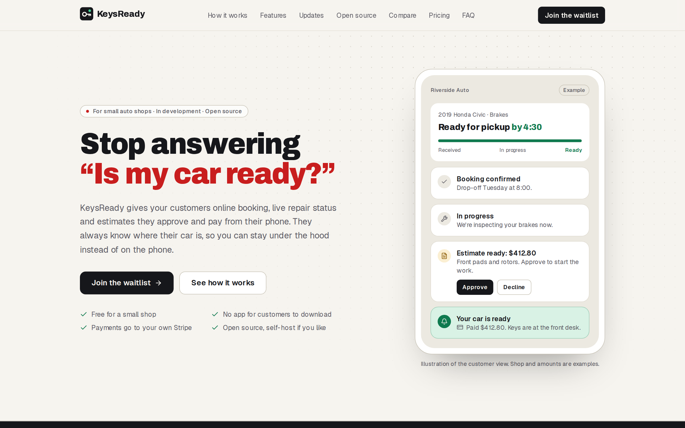

# KeysReady

**Stop answering "Is my car ready?"**

KeysReady gives small auto repair shops online booking, live repair status and estimates customers approve and pay from their phone.
Customers get a push notification at every step, from "booking confirmed" to "ready for pickup", without installing an app.



- Landing page: https://keysready.n8builds.dev
- Single-shop demo app: https://keysready.vercel.app

> **Status: in development.**
> The app runs end to end for one demo shop.
> Multi-shop self-signup, the packaged self-host release and the hosted beta are not built yet.
> Do not run it for a real shop's customers yet.

## What works today

- **Booking**: customers book a repair from their phone and can sign in with an email magic link to keep a garage of their cars.
- **Live status**: the shop moves a booking through `Pending`, `Confirmed`, `In progress`, `Ready` and `Completed`, and each change sends a Web Push notification.
- **Messages**: a two-way chat per booking, with a push to the other side on every new message.
- **Estimates and payment**: the shop builds an estimate from line items, the customer approves or declines it, then pays through Stripe Checkout; a signed Stripe webhook marks the booking paid.
- **Installable PWA**: no app store; on iPhone, add it to the Home Screen to receive push.

## Repository layout

| Path | What it is |
| --- | --- |
| [`web/`](web/) | The product: a Next.js 16 app (App Router, React 19, Tailwind CSS 4, TypeScript). Route handlers in `app/api/*` are the backend. Data in Turso/libSQL, notifications via Web Push, payments via Stripe. |
| [`landing/`](landing/) | The marketing page at keysready.n8builds.dev, a static Next.js export served by Cloudflare Workers. |
| [`sms-engine/`](sms-engine/) | A standalone two-way SMS engine (Twilio, consent, STOP/HELP, quiet hours) kept for a later paid SMS channel. It is not wired into `web/`. |

## Run it locally

```bash
cd web
npm install
cp .env.example .env.local   # then fill in SESSION_SECRET and the VAPID keys
npm run dev                  # http://localhost:2323
```

Locally the app writes to a SQLite file at `web/.data/app.db` and seeds a demo shop on first run.
Every environment variable is documented in [`web/.env.example`](web/.env.example); `.env.local` is git-ignored.
If you keep secrets in [`pass`](https://www.passwordstore.org/), [pass-env](https://github.com/n8watkins/pass-env) is an optional alternative to `.env.local`: list the names in a `web/.env.pass` file (names only, never values) and run `pass-env run -- npm run dev` from `web/`.
See [`web/README.md`](web/README.md) for the full setup, the demo shop login, and the end-to-end test.

## Stack

- **Next.js 16** on **Vercel**, with the API as route handlers (no separate server).
- **Turso / libSQL**: the same `@libsql/client` code runs against a local SQLite file and Turso cloud.
- **Web Push** (`web-push` + VAPID) for staff and customer notifications.
- **Stripe Checkout** for estimate payments; card data never touches the app.
- **Brevo or Resend** for magic-link email, with a console fallback in development.

## Commits and releases

Commits follow [Conventional Commits](https://www.conventionalcommits.org) (`feat: ...`, `fix: ...`, `docs: ...`), and releases are cut with [release-kit](https://github.com/n8watkins/release-kit); see [`RELEASING.md`](RELEASING.md).
`npm install` at the repository root turns on a `commit-msg` hook that checks each message, and CI checks pushed commits and pull request titles.
`npm run release:check` at the root installs `web/` and `landing/` and runs their lint, types and build; it is what a release runs before it publishes.

Releasing is optional and only for this repository: a fork never has to tag, release or set up anything.
The Release workflow runs only in `n8watkins/keysready`, so pushing a tag in a fork publishes nothing.
The hook only checks message format; `git commit --no-verify` skips it.

## Security

See [SECURITY.md](SECURITY.md) to report a vulnerability.

## License

[MIT](LICENSE) © 2026 Nathan Watkins
